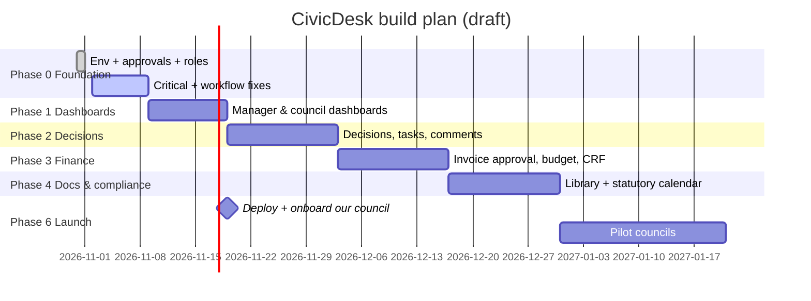

# CivicDesk — Product & Build Plan

_Living document. Last updated: 2026-10-31._

## Vision

Take a BC strata council and its strata manager **off email**. Every issue, decision, approval and
document for a building lives in one place, with a clear record of who decided what and when.

**Edge:** built by a sitting council treasurer, starting from real day-to-day council work, not a feature list.

**First customer:** our own council and our strata manager. Then other councils that use the same manager.

## Users (MVP)

| User | Account | Needs |
|---|---|---|
| Platform admin (me) | Superuser | Approve every building and member, see everything |
| Council member (President, VP, Treasurer, Secretary, Member-at-large) | Yes, one building | See what needs a decision, vote, track issues, see finances |
| Strata manager | Yes, many buildings | One place per building: open items, deadlines, approvals waiting on council |
| Owner / tenant | **No account** | Only token links (e.g. s.135 response portal) |

## Competitor: managestrata.ca

Features they advertise (reviewed 2026-10-31):

| Area | ManageStrata | CivicDesk today | Plan |
|---|---|---|---|
| Statutory deadline calendar (BC/AB/ON) | ✅ | s.135 deadline only | Phase 4 (BC only) |
| Document library + AI Q&A over bylaws/minutes | ✅ | ✅ Summaries by topic + Q&A with page citations | Phase 0.5 (built) |
| Meetings: notice, quorum, e-voting, minutes | ✅ | Council e-vote on bylaw cases only | Phase 2 (decisions) → Phase 5 (meetings) |
| Minutes approval workflow | ✅ | ❌ | Phase 5 |
| Finance: operating vs CRF, per-lot ledger, payments | ✅ | ❌ | Phase 3 (council-side first) |
| AI agents drafting reminders, council approves | ✅ | ❌ | Later |
| Prioritized action list dashboard | ✅ | Generic KPIs | Phase 1 |
| Owner portal (dues, repairs, voting) | ✅ | Token links only | Out of MVP scope |
| Data stored in Canada | ✅ | Not hosted yet | Host in Canada (Phase 6) |
| **s.135 bylaw enforcement end-to-end** | Not advertised | ✅ (our wedge) | Harden in Phase 0 |

**Positioning:** they are broad. We go deep on **council ↔ manager collaboration** (decisions,
approvals, finances, enforcement) for BC, where most of the email pain is.

## Architecture principles

- **Django apps = domains**: `core` (users, audit), `stratas` (buildings, memberships), `dockets`
  (bylaw enforcement), `payments` (parked). New domains get new apps (e.g. `decisions`, `finance`, `documents`).
- **Function-based views only.** Views stay thin: parse request → call service → render/redirect.
- **`services.py` per app** holds business rules and side effects (emails, state changes). Admin and views both call it.
- **QuerySet methods** for common reads (`Membership.objects.active().council()`).
- **Forms** validate all user input; never trust POSTed choice values.
- **Tenant boundary**: every query filters by `strata=request.strata`.
- **Additive migrations**; convert data in its own migration (Postgres needs that).
- **Every view gets tests** (Django `TestCase`, factories in `core/testing.py`).
- **Secrets only in `.env`**; features degrade gracefully when keys are missing (email falls back to console).

## Roadmap

### Phase 0 — Foundation _(in progress)_
- [x] Local environment running (Python 3.13 `.venv`)
- [x] Membership approval by platform admin; council positions incl. Treasurer; tests
- [x] Fix audit log silently dropping events
- [x] Lock down `log_incident_event` (fake owner responses)
- [ ] Workflow fixes: null bylaw crash, re-dispatch guards, duplicate fine dispatch, email-before-save ordering
- [ ] Hide Billing from nav (payments parked)

### Phase 0.5 — Document library (the "aha") _(built 2026-10-31)_
- [x] Upload building PDFs; AI summary by topic (Parking, Pets, Rentals…) with page links
- [x] "Ask your documents" with answers citing document + page; questions saved as history
- [ ] Try on our real bylaws once `ANTHROPIC_API_KEY` is added; tune the prompts
- [ ] Later: pick relevant documents first when a building has too many to send at once (600-page request limit)
- [ ] Later: summaries/answers on the dashboards; bylaw codes in Dockets linked to the bylaws PDF

### Phase 1 — Role dashboards
- [ ] Manager: per-building "needs action" list across portfolio (approvals, deadlines, cases)
- [ ] Council: "waiting on me" (votes, approvals), building activity
- [ ] Council meeting updates (to be added)

### Phase 2 — Replace email: decisions & tasks
- [ ] Council decisions/motions with e-vote (generalise the docket vote)
- [ ] Action items with owner + due date, comments per item
- [ ] Notification digest instead of reply-all chains

### Phase 3 — Treasurer & finance
- [ ] Invoice/expense approval (manager submits → council/treasurer approves)
- [ ] Operating budget vs actual, CRF balance tracking
- [ ] Monthly financial statements upload + sign-off

### Phase 4 — Documents & compliance
- [ ] Document library (bylaws, minutes, insurance, depreciation report, contracts)
- [ ] BC statutory calendar (AGM, insurance renewal, depreciation report, etc.) with reminders

### Phase 5 — Meetings
- [ ] Agenda, minutes drafting, minutes approval

### Phase 6 — Launch
- [ ] Deploy to `usecivicdesk.com` (Canada-hosted), Resend domain verified
- [ ] Onboard our council + manager; collect feedback; then 2–3 pilot councils

## Timeline (draft)

> Deploying right after Phase 1 lets our council start using it while later phases are built.

## Go-to-market notes

- Start with our own council and manager; their feedback shapes Phases 2–3.
- Then councils served by the same management firm (one warm intro, many buildings).
- Content: short LinkedIn posts on CRT decisions about procedural mistakes.
- Pricing: per building per month; decide after the first pilot.
