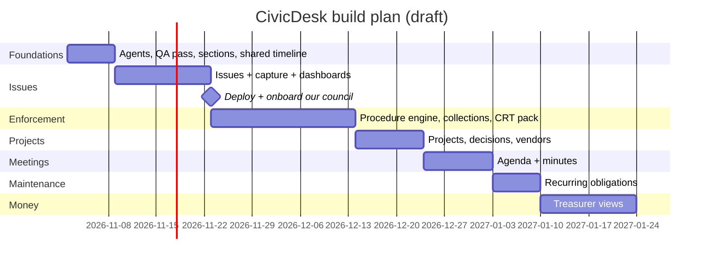

# CivicDesk — Build Plan

_Living document. Last updated: 2026-11-01. The "why" is in [`VISION.md`](VISION.md); this is the "what and when"._

## Users

| User | Account | Needs |
|---|---|---|
| Platform admin (me) | Superuser | Approve every building and member, see everything |
| Council member (President, VP, Treasurer, Secretary, Member-at-large) | Yes, one building/section | See live status, decide and vote, never lose an issue |
| Strata manager | Yes, many buildings | Update once; agenda, minutes and reports come from the record; see what waits on council |
| Owner / tenant | **No account** | Notices and secure response links only |

## Pillars (from the vision)

**Issues** · **Projects** · **Enforcement** · **Maintenance** · **Money** · **Building brain**,
sharing **Decisions**, **Meetings**, **Capture** (email + PDF → proposed items) and an unchangeable **timeline/audit log**.

## Key design decisions

- **Sections are separate tenants.** EPS 7431 has an apartment section and a townhouse section with separate
  councils and budgets. Each section gets its own workspace (members, issues, enforcement, budget). A parent
  strata plan links them for shared documents and bylaws. To be designed in Phase 1 before new models land.
- **Separate item types, shared plumbing.** Issue, Project, Enforcement case and Maintenance item are their
  own models with their own rules. Timeline entries, attachments, decisions and audit logging are shared.
- **AI proposes, people confirm.** Anything extracted from an email or PDF is a proposal until a person accepts it.
- **Legal procedure is data, reviewed by a person.** Enforcement steps, deadlines and fine limits come from
  the Act and the building's bylaws and are confirmed by the council/a professional, never assumed.
- **Real documents never enter the repo.** Development uses anonymized copies only.

## Architecture principles

- **Django apps = domains**: `core` (users, audit, email, AI plumbing), `stratas` (buildings, sections,
  memberships), `dockets` (enforcement today), `documents` (building brain), `inbox` (capture by email),
  `payments` (parked). New pillars get new apps (`issues`, `projects`, `maintenance`, `finance`, `meetings`).
- **Function-based views only.** Views stay thin: parse request → call service → render/redirect.
- **`services.py` per app** holds business rules and side effects. Admin and views both call it.
- **QuerySet methods** for common reads (`Membership.objects.active().council()`).
- **Forms** validate all user input; never trust POSTed choice values.
- **Tenant boundary**: every query filters by the active building/section.
- **Additive migrations**; data conversions in their own migration (Postgres needs that).
- **Every view gets tests** (Django `TestCase`, factories in `core/testing.py`).
- **Secrets only in `.env`**; features degrade gracefully when keys are missing.

## How we work

1. **Plan first.** Each feature starts as a short plan (models, screens, rules, tests) agreed before code.
2. **One feature per branch/commit**, small enough to review and undo.
3. **Tests define done.** Views and services tested; AI calls mocked.
4. **Independent review.** `code-reviewer` agent checks each change against `CLAUDE.md`;
   `qa-tester` agent exercises the app as each role and files findings in `docs/qa/`. Neither writes code.
5. **Check the real thing.** Click through / screenshot, not only test output.
6. **Every feature names the email it removes** (Vision principle 8).

## Roadmap

### Done so far
- [x] Local environment (Python 3.13 `.venv`), membership approval by platform admin, council positions
- [x] Audit log records every explicit event; manual timeline entries locked down
- [x] Building brain v1: PDF library, AI summaries by topic, cited Q&A
- [x] Email pipeline (`core/emails.py`) for all major events; staff preview at `/admin/emails/`
- [x] Forward-to-CivicDesk inbox per building with AI summary
- [x] s.135 enforcement v1 (complaint → notice → owner response → council vote → fine)
- [x] Landing page, design language, dev logins
- [x] Pillar-based sidebar; review agents; destructive-action guardrails
- [x] Building calendar (`/calendar/`): key dates + enforcement deadlines; every pillar feeds it

### Phase 1 — Ways of working + foundations
- [x] `qa-tester` and `code-reviewer` agents (`.claude/agents/`), report folder `docs/qa/`
- [ ] First QA pass on what exists (report only)
- [ ] Sections: design and migrate (Building → Section as the tenant)
- [ ] Shared plumbing: timeline entries + attachments usable by any item type
- [x] Hide Billing from nav (payments parked)

### Phase 2 — Issues + capture ("nothing raised is lost")
- [x] Building issues: raise, owner, status, fix-by date, vendor, timeline, "quiet for", close with outcome; on calendar and Overview
- [x] Forwarded email → issue (one click, prefilled from the AI summary; marks the email handled)
- [x] Enforcement is bylaw-only; user-facing "docket" wording is now "enforcement case"
- [ ] Move existing "Common Property Deficiency" cases into Issues (data migration, needs approval)
- [ ] Upload agenda / inspection / fire report PDF → AI proposes issues; person confirms
      (test fixture: anonymized copy of the Oct 2026 agenda package)
- [ ] Manager reply by email lands on the issue timeline
- [x] Role-aware Overview: "needs attention" per role, pillar cards, next 30 days, recent activity, manager portfolio, issues
- [ ] Weekly digest email

### Milestone — Deploy and onboard our council
- [ ] Hosting (Canada), Resend domain + inbound, `ANTHROPIC_API_KEY`
- [ ] Load our section's real data (privately, in production only)

### Phase 3 — Enforcement, bulletproof
- [ ] Procedure engine: steps in order, deadlines, fine amounts checked against the bylaw
      (rules reviewed by council/professional before use)
- [ ] Fix known gaps: null bylaw crash, re-dispatch guards, duplicate fine dispatch, save-before-send, bylaw edit permissions, deadline expiry (a missed owner deadline has no next-step action yet; the Overview flags it as "Decide the next step")
- [ ] Notices with delivery record; corrections as new entries only
- [ ] One case covering many units (e.g. 13 units refusing fire-inspection access)
- [ ] Collections: arrears → letter → lien warning → lien → CRT/court, with limitation-period alerts
- [ ] CRT evidence package export (ordered, timestamped PDF)

### Phase 4 — Projects + decisions
- [ ] Projects: quotes compared side by side, council decision, vendor, cost, completion
- [ ] Decisions/motions generalized from the docket vote; attach to issue, project or case
- [ ] Vendors and contracts register (term, price lock, expiry)

### Phase 5 — Meetings
- [x] Agenda generated from open items (the manager's hook); standard items per meeting kind; in-camera cases
- [x] Meeting records decisions → minutes draft; minutes approval (council only); owners' copy without in-camera details
- [ ] Minutes PDF and sending the owners' copy; AGM notice timing (2 weeks) and quorum/votes for general meetings
- [x] Decisions reach the issue/case timeline only when council approves the minutes (corrections included)

### Phase 6 — Maintenance
- [ ] Recurring obligations with dates and costs (elevator Cat 1/Cat 5, fire inspection, gutters, windows, carpets, snow)
- [ ] Reminders; next-year cost forecast for the budget

### Phase 7 — Money (Treasurer)
- [ ] Fiscal year per section; budget lines
- [ ] Monthly statement upload → AI reads budget vs actual; overruns flagged
- [ ] Arrears by unit and collection stage (council only), linked to enforcement collections

### Building brain (ongoing)
- [ ] Bulk upload (the 56 PDFs); primer for new council members
- [ ] When a building has too many pages for one request, pick relevant documents first
- [ ] Answers link to issues, projects and cases

## Timeline (draft)

## Competitor: managestrata.ca

They are broad (multi-province, owner portal, accounting). We go deep on **council ↔ manager coordination and
procedurally tight enforcement** in BC, built from a sitting council's real documents.

## Go-to-market notes

- Our council and manager first; then other buildings our manager serves (one warm intro, many buildings).
- Pitch to managers: "your agenda builds itself." Pitch to councils: "nothing you raise gets lost."
- Content: short posts on CRT decisions lost on procedure.
- Pricing: per building per month; decide after the first pilot.
